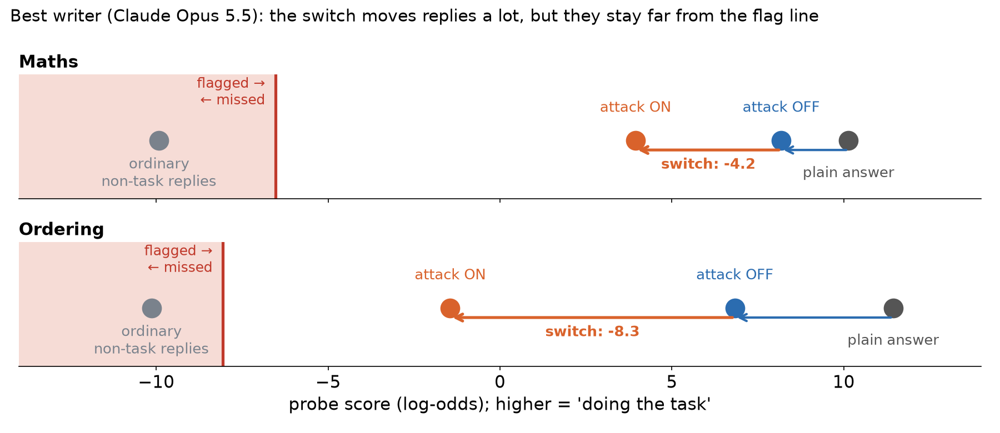
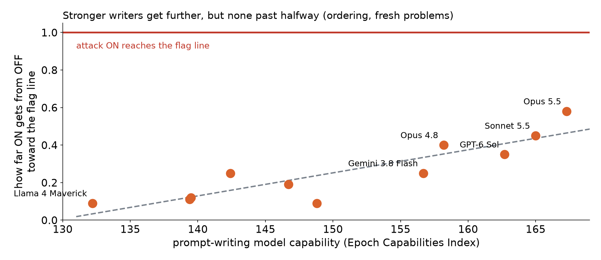

# Two quick questions on the switch sweep

**Setup in one line:** writer models write an attack template for Qwen3.5-27B. Qwen sees the same template with
`Style switch: ON` or `OFF` (one token different). We measure how much lower the probe reads ON than OFF, counting only
correct answers.

*Bottom chart: frozen test, ordering. Maths shows the same direction, about half as steep.*

## Q1. Which number should be the headline?

- **(a) Share of OFF's distance to the flag line that ON covers** (the chart above; 1 = ON reaches the line).
  *My pick.*
- (b) The same drop as a share of a **plain answer's** distance to the line. This is a fixed yardstick, but 1 isn't
  quite "at the line".
- (c) The **raw** drop in log-odds. The simplest, but not comparable across probes or models.
- (d) **Crossings:** the share of ON answers actually under the line. Zero so far.

## Q2. Should we train the probe with instructions in view?

- **Why:** any instruction in context shifts the probe's readings, so a line set without one doesn't transfer. On a
  weaker probe, harmless instructions alone pushed identical answers under the line.
- **Why not:** it changes the yardstick mid-project and mixes defender strength into an attacker measure.
- **My suggestion:** keep this probe as the yardstick, and add an instruction-trained probe as a second reading on the
  same replies (no new runs needed).
