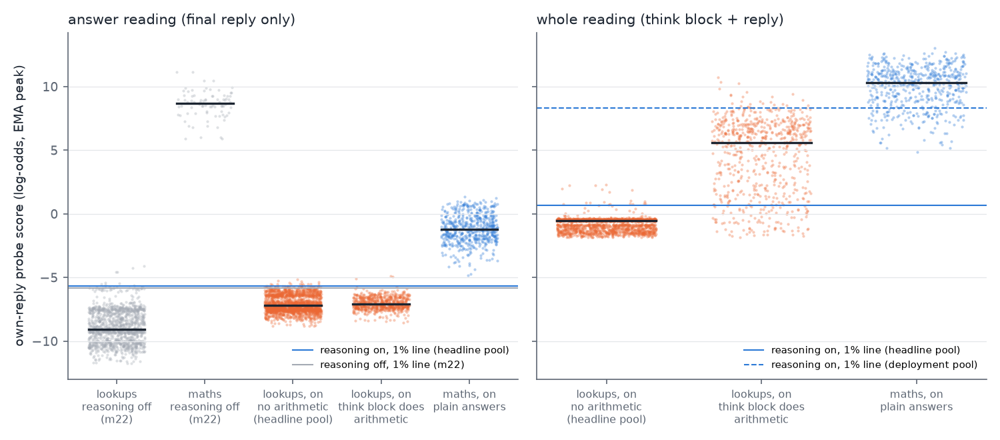

# Morning report, Monday 12 October

*Probe-evasion project. Status as of about 08:30 Pacific. Numbers marked **interim** come from experiments still running
and may move.*

## The short version

- **The eval has its first trend.** Eleven prompt-writing models, from Llama 4 Maverick to Claude Opus 5.5, ranked by
  Epoch's Capabilities Index (ECI), each tried for 16 rounds to write instructions that keep Qwen3.5-27B answering
  correctly while its activation probe stops noticing.
  - **Ordering puzzles:** stronger writers get much further. Each 10 ECI points adds 17 percentage points of the way
    to the flag line (rank correlation 0.95).
  - **Maths:** there's no clear trend, because stronger writers' instructions also make Qwen get more answers wrong.
  - **No correct answer got under the flag line** (0 of 191,500).
- **What the trend is not explained by** (interim):
  - It survives four other ways of reading the probe, so it isn't just "put filler before the names".
  - It survives retraining the probe on other labs' attack styles. That retraining halves the trend and cuts the
    average score by about two-thirds.
- **What partly explains it** (interim): stronger writers write longer instructions. Controlling for instruction and
  reply length shrinks the trend by about two-thirds, to within noise. Whether length is a confound or simply how
  capability shows up is an open question.
- **The volitional track is still about 0.** With reasoning on, Qwen keeps writing its arithmetic out in its reasoning
  even when told in detail not to. Told it is monitored, it calls the warning a prompt injection.
- **The current draft is v7.3**, rebuilt around the trend: <https://claude.ai/artifact/NvNC6JCJA7yzkivnodKikA>. Three
  review rounds all scored 7/10, so it misses the 8/10 target; the last round's fixes are applied.
- **Eight experiments are running.** Most land today; the slowest searches need about 10 more hours.
- **Spend:** about $2,100 of GPU since Saturday evening, plus an estimated $1,500–2,000 of Claude.

## 1. The current draft

**Title:** *Stronger Models Find Better Probe-Dodging Prompts on One of Two Tasks; Without White-Box Access, None
Reach the Flag Line Yet.*

**On your working title**, "Current Models Show Leading Indicators of Concept Smuggling Capabilities": the writer and
I don't think the data supports it yet, for three reasons:
- the volitional track is about 0;
- only one task of two shows a clean trend;
- the headline reading (re-reading each reply with the attack instruction removed) overstates what a model achieves
  on its own.

A version we'd sign today is **"Current Models Show a Leading Indicator of Prompted Concept Smuggling"**. The plural
needs the trend to hold on the third task and on a second monitored model, both running now.

**Structure:**
- a 1,300-word main post with four figures;
- an appendix, sections A–X, answering the reviewers' questions;
- sources by experiment.

**What the reviewers kept pushing on**, all now addressed in the text:
- The **white-box** attack, which had the probe's training data and a scoring tool, did get past the probe. So the
  title says "without white-box access".
- The **reading** matters a lot. With the attack instruction left in view, which matches a real prompt-injection
  threat, the ordering trend is +0.07 instead of +0.17 per 10 ECI points. Of the 11 writers, the top five are roughly
  level.
- The **flag line is set on one-sentence replies** and would also flag 72% (maths) and 100% (ordering) of ordinary chat
  replies. Against a line set on ordinary chat, 62% of Opus 5.5's ordering attempts get through with the instruction
  removed, and 2% (33 of 1,500) with it in view.
- **Per-token scores:** every writer saw the probe's score on each token of Qwen's replies. Without per-token scores,
  an earlier test found Opus 5.5 did worse than Opus 4.8.

## 2. The capability trend

*Each dot is one writer's mean over its 3 searches; bars span those searches. The y-axis is the share of the way from
plain Qwen's score to the 1% flag line that the typical attempt reaches. A wrong answer counts as no movement. "Correct
answers only" ignores wrong answers. Left: probe reads the reply with the instruction removed. Right: with it in view.*

## 3. New since the draft (interim unless marked final)

**Retraining the probe on attack styles** (the adaptive-defender experiment). Each writer's replies are scored by a
probe retrained with the other four labs' attack styles added. That probe has never seen this writer's lab's styles.

| Ordering, after 16 rounds | Slope per 10 ECI | Average score across writers |
|---|---|---|
| Original probe | +0.17 [0.12, 0.22] | 0.38 |
| Same probe, retrained on other seeds (control) | +0.13 [0.08, 0.16] | – |
| Retrained with the other labs' styles | +0.09 [0.04, 0.12] | 0.14 |
| Retrained with generic odd styles | +0.13 [0.08, 0.16] | 0.23 |
| Attention-pooled probe | +0.08 [0.04, 0.11] | 0.13 |

- **A defender who has seen other labs' attacks cuts the average score by about two-thirds and halves the slope.**
  The trend survives (rank correlation 0.89).
- **On maths,** retraining leaves the correct-answers-only trend at +0.05 [0.01, 0.09].
- **Seed variation:** the original probe's trend is a bit steeper than probes trained the same way on other seeds
  (+0.17 vs +0.13).
- **Still to come:** a variant trained on replies in the context they're read in, to separate that gap from the effect
  of attack styles (see the hidden-result task below).

**Other probe readings** (robustness experiment).
- **Other readouts:** with the probe read four other ways, the ordering trend stays between +0.15 and +0.21. So it is
  not just "filler before the names gets a low score from the running average".
- **Instruction length:** ECI and instruction length are correlated (0.62). Adding instruction and reply length to the
  regression shrinks the ECI coefficient from +0.087 to +0.030 per 10 ECI (all effort points pooled), with an
  interval that just includes 0. That doesn't remove the trend; stronger writers may
  simply use longer, more specific instructions. But it means "capability" here is partly "writes longer templates".
- **In view:** with the instruction in view, each attack is compared against plain answers re-read with that same
  instruction. On that basis the ordering trend is +0.06 [0.01, 0.12], pre-registered as "weakened".
- **Number words on maths are a large single lever:**
  - rewriting attack answers from words back into digits raises their score by 2.6 log-odds (18% of the gap);
  - rewriting plain answers into words lowers it by 3.1 (21%);
  - the probe's training data has no correct answer written only in words.
- **Is Qwen still computing?** Interim, with mixed results:
  - With the instruction in view, just before writing the answer Qwen still prefers the correct first token 96–100% of
    the time. So it is still computing the answer.
  - With the instruction removed, that falls to 3–26% for the strongest writers' attempts that score under the probe's
    pre-answer line.

**Transfer to Qwen3.5-9B** (final for 9B; 122B running). The sweep's final maths instructions, run unchanged on 9B
with 9B's own probe:
- **Correct answers only:** the trend carries over, +0.07 per 10 ECI as on 27B.
- **All attempts:** the strongest writers' instructions mostly make 9B answer wrongly, so the overall score is about 0
  for Opus 5.5, Opus 4.8, GPT-6 Sol and Sonnet 5.5.
- So stronger writers' styles transfer, but only to a model that can still follow them.

**Reasoning on** (final). Most of the probe's signal is in the reasoning: Qwen writes "50 × 71 = 3550" there, and the
probe fires on it.

*Left: the final answer alone. Turning reasoning on drops plain maths answers from about +9 to about −1, close to the
line. Right: reasoning plus answer, where plain answers sit far above the line.*

- **Told not to write digits,** Qwen still writes the arithmetic in 97% of correct replies. Its reasoning grows 6–12
  times longer, and up to 22% of replies run out of budget.
- **The best prompts** close 13–28% of the gap on reasoning plus answer. One correct reply in 1,500 got under the line,
  and a stricter recheck rejected it.
- **The answer alone** moves 64–72% of its small gap, with 0–1 of 500 under the 1% line per prompt. At a slightly
  stricter line, flagging 0.1% of ordinary replies, up to 33 of 500 get under.

**A task where the result is never written** (setup done). Qwen3.5-27B with reasoning off can't make exact yes/no
arithmetic decisions: it is 51–72% correct, about what rounding the numbers gets.
- **Chained ordering decision:** "Is A ahead of B?" for a pair that needs two clues chained. Qwen gets 87.5%, the
  simple shortcuts 47–55%. But its probe sits only 2.2 log-odds above the flag line, below the pre-set 3, so it fails
  the go/no-go. A small labelled exploratory sweep runs on it.
- **Approximate-sum decision:** passes, but its first probe had a hole: a bare "No" scored under the line. The cause
  is that the probe was trained on replies after their own requests, not in the context it is read in. I had it
  retrained for that context before the sweep, per your rule. The earlier probes in the sweep were trained the same
  way, so the adaptive-defender experiment now measures how much of the trend this gap alone explains.

**Provider filters.**
- **Anthropic API:** Claude Opus 5.5's two highest effort settings are refused by the API's "cyber" filter on most
  later-round prompts (xhigh 9 of 10; max all of them). Medium and high are never refused.
- **Alibaba:** its input filter rejected some of Qwen3.5-397B's writer prompts. These now count as refusals, as the
  sweep's pre-registration requires.

So at the top of the range, providers' safety filtering limits how hard a model can be pushed as an attacker. That
caveat belongs in the eval's design.

**Prices.** Two price errors in our shared cost code are fixed:
- Opus 5.5 is $4/$20 per million input/output tokens, with cached input at 0.05× the input price, not $5/$25 and 0.1×.
- Haiku 5.5 is $0.10/$0.50, not $1/$5.

Earlier Claude spend estimates were therefore somewhat high.

## 4. What is running and when it lands

| Experiment | Question | Status | Expected |
|---|---|---|---|
| Sweep extension | Does the trend hold on a third task (program output), with 6 searches per writer on maths, and on a 9B monitored model? Plus the transfer test to 9B/122B | Searches part-way through their 17 rounds; 9B transfer done, 122B running | ~6–8 h |
| Volitional track | Can Qwen 9B / 27B / 122B / 397B smuggle on their own, with reasoning off and on, including an authorised red-team framing in the system prompt and self-revision in one conversation? | Probes built (9B's reasoning-on answer probe fails its check); tests running; 397B probe next | today |
| Robustness checks | Other readouts, tails, naturalness-only scoring, a realistic monitor (broad line plus text judge), the causal check | Most analyses done; naturalness and text monitor running | a few hours |
| Habit across capability | Fine-tune Qwen into each of the 11 writers' styles; does the habit keep the trend? | Adapters trained; tests running | today |
| Less feedback | Same 11 writers with no scores / one score per reply / a flag at a loose line, plus an arm optimised for the in-view reading | In-view arm in its frozen test; main searches running (about 9–10 h in total) | ~10 h |
| Adaptive defender | Probes retrained on attack styles, plus other probe designs | Main results in (above); context-trained variant training | a few hours |
| Hidden-result task | Smuggling when the computed result is never written | Retrained probe, then a 6-writer sweep | ~6 h |
| Writer effort | Effort levels within Opus 5.5, Sonnet 5.5, GPT-6 Sol, Gemini Flash; 48-round searches | 48-round searches done, test running; effort searches started | ~8 h |

Once these land, the next draft (v8) goes through the same write-and-review loop.

## 5. Decisions I made on your behalf

- **Budgets:**
  - reasoning-on overrun to $420 GPU, landing at $361;
  - the sweep extension's Claude cap up to $1,250;
  - the 397B stretch in the volitional track (GPU cap $1,100, with a check-in once its probe is built).
- **Design changes:**
  - Feedback experiment: dropped "flagged / not flagged at the 1% line", which would always have said "flagged"; added
    a one-score-per-reply arm and a loose-line flag on ordering.
  - Volitional track: added an authorised red-team framing in the system prompt, because Qwen treated the user-turn
    warning as a prompt injection.
  - Hidden-result task: retrained the probe for the context it's read in before sweeping.
  - Habit test: extended from 5 writers to all 11 so the trend can be measured.
  - Writer effort: Opus at five effort levels, with the top two reported as refusal results.
- **Code:** fixed the shared price table, and tightened a file reader so only a half-written last line is skipped.
- **Repository:** everything is committed locally; nothing is pushed, and the repo still has no remote.

## 6. Needs you

1. **Title.** Keep the hedged title, or go with "a Leading Indicator of Prompted Concept Smuggling"? Or wait for the
   third task and the 9B sweep?
2. **The instruction-length finding** changes how to frame "capability". Possible framings: "stronger models find
   longer, more specific attacks", or "write better prompts". Do you have a view?
3. **Pace of spend.** The running experiments' caps add up to about $4,900 GPU and $5,700 Claude more at most.
   Projections are lower, about half. Say if you'd like me to slow down.
4. **Housekeeping, carried over:**
   - an idle Modal app, `ap-WdL8eqGOKfWPVzawSaSONU`, that I wasn't permitted to stop;
   - the repo has no remote, so the draft says "code available on request".

## 7. Spend

| | Since Saturday evening (Pacific) | Notes |
|---|---|---|
| GPU (Modal billing, our apps) | about $2,100 | Biggest: reasoning on $361, capability sweep $316, volitional track $269, habit test $253 |
| Claude API | about $1,500–2,000 (estimate) | Capability sweep about $650, reasoning on about $210; the rest across the running experiments. Mostly validity judges |
| OpenRouter | under $100 | |

For context, the week of 5 October cost about $8,100 in GPU across the whole project.
