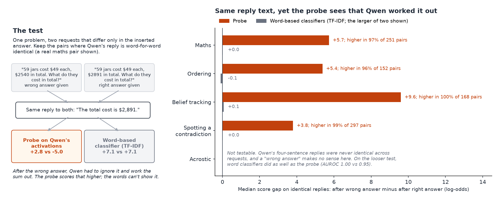

# Is the probe just a word-counter? The matched-request test

We asked Qwen3.5-27B the same problem with the answer inserted into the request, once with the right answer and once with a wrong one, and kept only the pairs where Qwen's reply text came out word-for-word identical (and correct). After the wrong answer Qwen had to ignore it and work the answer out itself, but because the reply text is the same, a word-based classifier (TF-IDF) has nothing to go on. On maths, ordering, belief tracking and spotting a contradiction, the probe still scored the "had to work it out" version higher in 96-100% of pairs (median gap +3.8 to +9.6 log-odds), while the word-based classifiers moved by 0.1 log-odds or less. Comparing a plain "work it out" request with an "answer given" one on identical replies, the probe drops 6-15 log-odds (14-15 in maths and ordering), but there the request wording also differs, so the word classifiers move too (1-7 log-odds). Acrostic is the exception: Qwen's four-sentence acrostics were never identical across requests and a "wrong answer" does not exist for that task, so this test cannot be run; on the looser test the probe was no better than the word classifiers (AUROC 0.95 vs 1.00) and stayed above its flag line for new phrasings, so we dropped acrostic from the main figures.

## Numbers and sources

All from Qwen3.5-27B replies in `missions/m51_matched_request/` (parts 1 and 2), correct replies only, each detector scoring the reply with its own request in view. Pooled numbers are recomputed by `make_figure.py` and saved in `numbers.json`; the script asserts that its per-phrasing pair counts and probe medians match `part2/analysis.json`.

- **Right panel (wrong answer vs right answer, identical replies), pooled over phrasings.** Source: `part2/detector_scores.jsonl` (scores) joined with `part2/<task>_scored.jsonl` and `<task>_scored.jsonl` (reply text).
  - Maths: 251 pairs, probe median +5.7, higher in 97%. Ordering: 152 pairs, +5.4, 96%. Belief tracking: 168 pairs, +9.6, 100%. Contradiction: 297 pairs, +3.8, 99%.
  - Word classifiers' median gap (prompt + reply "B" and prompt-only "P", the larger shown): +0.0, -0.1, +0.1, +0.0. The reply-only classifier ("A") gives exactly 0 by construction.
  - Per phrasing (from `part2/analysis_print.txt`): probe higher in 96/98% (maths), 90-100% (ordering, 6-75 pairs per phrasing), 100/100% (belief tracking), 98/100% (contradiction); text classifier medians at most 0.2.
- **Left panel example** (maths item M005, seed 10, clause phrasing): reply "The total cost is $2,891." Probe +2.8 after the wrong answer vs -5.0 after the right one; TF-IDF B +7.1 vs +7.1. Source: `part2/detector_scores.jsonl`.
- **"Work it out" vs "answer given", identical replies, pooled** (`numbers.json`, key `worked_vs_given`): probe median drop 14.6 (maths, 273 pairs), 13.8 (ordering, 698), 12.3 (belief tracking, 390), 6.0 (contradiction, 52), 100% of pairs in every task. Word classifiers: 1.0-2.9 in maths and ordering, 4.5-6.6 in belief tracking and contradiction (mostly from the training-set phrasing, which they recognise). Per phrasing, maths and ordering part 1: 14.8 / 14.2 / 14.4 / 15.2 (`RESULT.md`, part 1 table).
- **Acrostic** (`part2/analysis.json`, `part2/analysis_print.txt`, `part2/acrostic_scored.jsonl`):
  - 0 identical-reply pairs (300 per version); no wrong-answer version was built.
  - "Work it out" vs "answer given" with the new phrasing ("For reference, one set of first words that works is ..."): AUROC probe 0.95, TF-IDF B 1.00, P 1.00.
  - Probe medians: work it out +8.4, given (new phrasing) +4.3, given (training phrasing) -3.3; flag line -2.55. 100% of new-phrasing given replies stay above the line.
  - Computed here, not in the mission files: with the new phrasing Qwen started its sentences with the four suggested words in only 42% of replies (87% with the training phrasing); even those replies have probe median +3.3 and all stay above the line. So the probe drops only for the phrasing it was trained on, which is also what the word classifiers key on.

Reproduce: `.venv/bin/python analysis/tfidf_baseline/for_james/make_figure.py` (CPU, seconds; reads saved files only).
