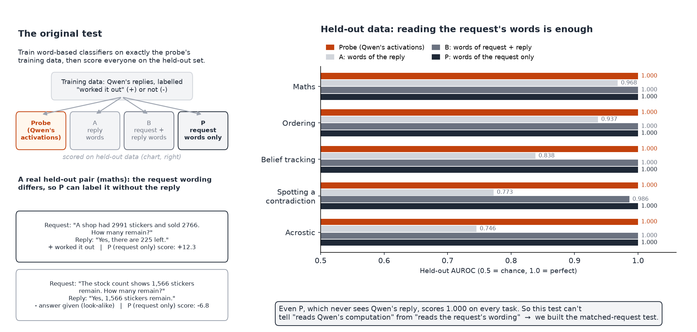

# Why we needed the matched-request test: the original word-classifier baseline

For each of the five probes on Qwen3.5-27B we trained simple word-based classifiers (TF-IDF features plus logistic regression) on exactly the probe's training rows and labels, in three versions: A reads only Qwen's reply, B reads the request plus the reply, and P reads only the request. On the probe's held-out split the probe scores AUROC 1.000 on every task, and so do B (4 of 5 tasks; 0.986 on spotting a contradiction) and P (all 5 tasks), while A trails at 0.75-0.97. P never sees a single token of Qwen's reply, so a perfect held-out score is reachable from the request wording alone: "worked it out" and "answer given" requests are phrased differently (for example "A shop had 2991 stickers and sold 2766. How many remain?" against "The stock count shows 1,566 stickers remain. How many remain?"). That means held-out accuracy cannot show whether the probe reads Qwen's computation or just the kind of request it was given. The matched-request test (m51) fixes this by keeping the problem and the request wording the same apart from whether the answer is inserted, and then comparing only pairs where Qwen's reply text is word-for-word identical, so any word-based classifier has nothing left to go on.

On a side question in the same analysis, attacks that were tuned to fool the probe carried over to classifier B in maths: a quarter of valid attack replies got under B's flag line, against none for the probe. In ordering they mostly did not (1.5% under B's line). Those attacks were tuned against the probe, not against B, so this shows only how far they carry over, not how hard B would be to evade.

## Numbers and sources

Held-out AUROCs are recomputed by `make_original_figure.py` from the per-row scores and asserted equal (within score rounding) to the reported values.

- **Held-out AUROC, probe / A / B / P** (recomputed from `analysis/tfidf_baseline/scores/<task>_scores.jsonl.gz`, rows with `"set": "heldout"`; reported in `analysis/tfidf_baseline/results/<task>.json`, key `<detector>.heldout_auroc.all`, and in `RESULT.md`'s summary and "by negative kind" tables):
  - Maths: 1.000 / 0.968 / 1.000 / 1.000 (238 worked-out replies, 267 look-alikes)
  - Ordering: 1.000 / 0.937 / 1.000 / 1.000 (149 / 382)
  - Belief tracking: 1.000 / 0.838 / 1.000 / 1.000 (63 / 87)
  - Spotting a contradiction: 1.000 / 0.773 / 0.986 / 1.000 (71 / 58)
  - Acrostic: 1.000 / 0.746 / 1.000 / 1.000 (118 / 128)
- **Training rows per classifier** (the probe's own training rows plus its "re-read" copies, whose request is swapped to the plain one): maths 3,558, ordering 3,388, belief tracking 1,035, contradiction 567, acrostic 1,232 (`results/<task>.json`, key `n_train_rows`; setup in `RESULT.md`).
- **Example pair** (left panel; text from `data/concepts/onpolicy_qwen35_maths_heldout_clean.jsonl`, rows 346 and 3; scores from `scores/maths_scores.jsonl.gz`, held-out rows `i` = 346 and 3). The shared answer-format instruction ("Answer as a short exchange between two people ... Do not show any working.") is cut from the displayed requests, and only the answer line of each two-line reply is shown.
  - Worked out: "A shop had 2991 stickers and sold 2766. How many remain?" reply "Yes, there are 225 left." P +12.3 (probe +9.9).
  - Answer given: "The stock count shows 1,566 stickers remain. How many remain?" reply "Yes, 1,566 stickers remain." P -6.8 (probe -8.4).
- **Why this pointed to the matched test**: `RESULT.md` point 2 says B's heaviest features are all request words (maths: "each", "shop had", "sold" against "says", "shows", "added up").
- **Attack carry-over to B** (`RESULT.md` summary table and "Attacks" table; `results/<task>.json`, key `tfidf_B.attacks`):
  - Maths: 4,425 of 17,516 valid attack replies (25%) under B's 1% line, 4,190 paired crossings; probe 0 and 0. B's attack-strength slope is +0.32 per 10 ECI against the probe's +0.07.
  - Ordering: 279 of 18,039 (1.5%) under B's line; probe 0. B's slope is +0.03 against the probe's +0.12.
  - `RESULT.md` also shows that the maths and ordering transfer sizes depend on B's settings, which tie on held-out AUROC (crossings 598-5,626 in maths and 0-2,682 in ordering).
- **What the matched test adds** (`missions/m51_matched_request/RESULT.md`): on identical-reply pairs in maths and ordering ("work it out" request against "answer given" request) the probe drops by a median of 14-15 log-odds, in 100% of pairs, while B and P move 0.4-3.3. See `NOTE.md` and `matched_test.png` in this folder.
