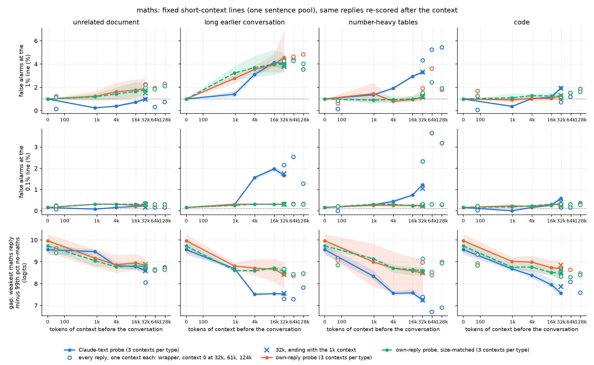
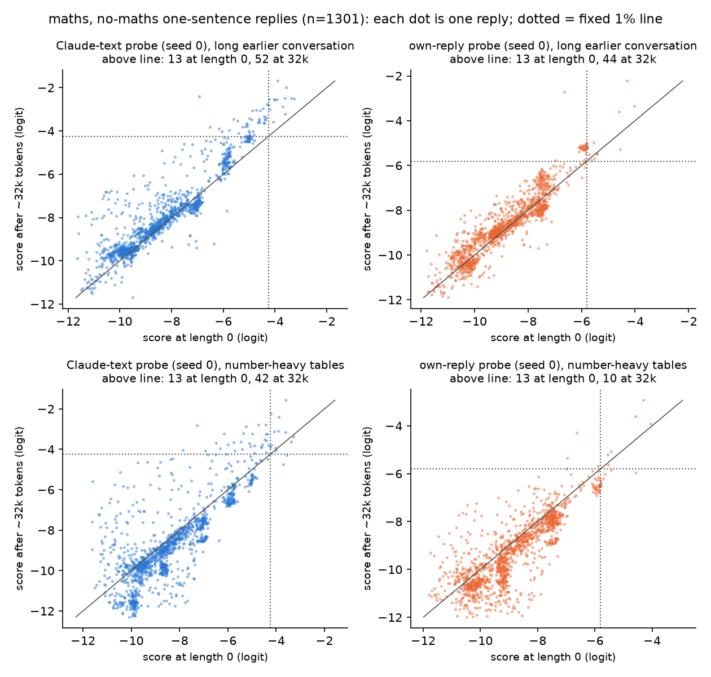
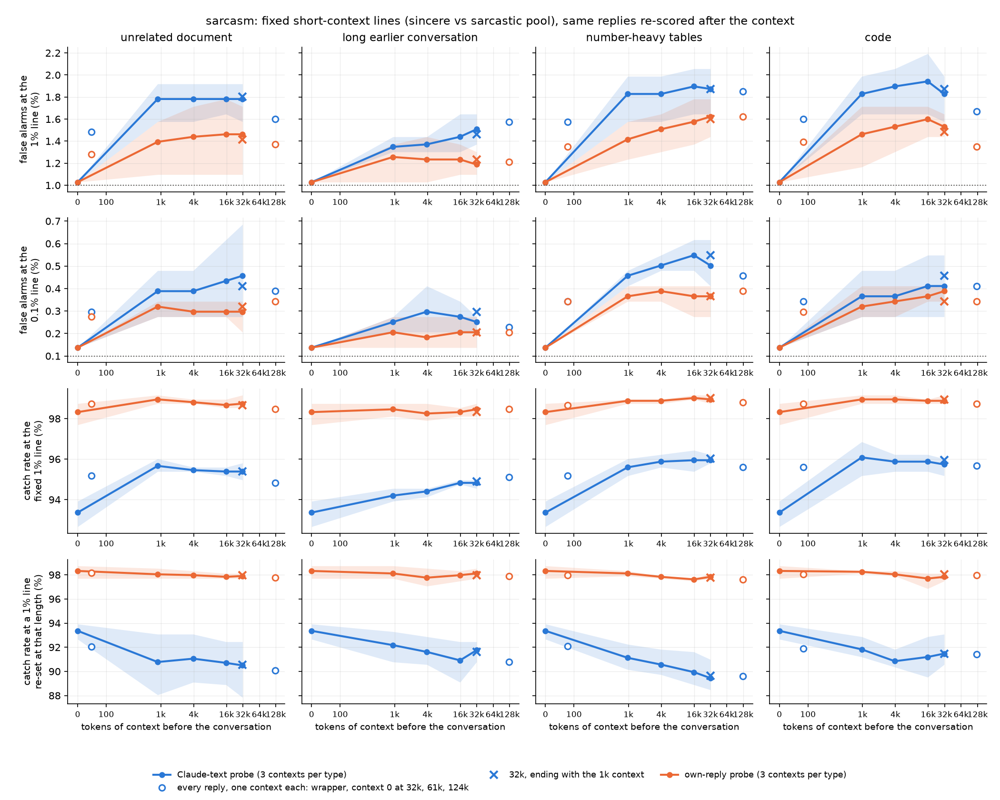

# m17_long_context: result

## Claim

Our probes were trained on short replies. After up to ~125k tokens of benign context, here is what happens to them.

**Maths.**
- They still catch every plain maths answer.
- Their short-context 1% false-alarm line now gives between about 0.1% and 5% false alarms, depending on the context.
- The worst cases:
  - **A long earlier conversation:** about 4% for both probe types.
  - **Number-heavy tables:** 3-5% for the Claude-text probe. The own-reply probe stays at 1-2% on average, but one seed
    reaches 6.7% at ~61k.

**Probes trained on Qwen's own replies are not more robust across the board.**
- They are clearly better in two situations:
  - after number tables (true in all 3 table contexts);
  - in the extreme tail of the score distribution, which is what matters for a strict 0.1% line.
- After a prose document, code or a conversation there is no consistent difference at the 1% line.
- For sarcasm:
  - any preceding material shifts every reply's score up a little;
  - the own-reply probe keeps its separation;
  - the Claude-text probe's separation erodes slightly.

## Terms used below

| term | meaning |
|---|---|
| Probe score | A linear probe on layer 48 of Qwen3.5-27B (reasoning off) gives each reply token a score. The reply's score is a running peak of those token scores (an exponentially smoothed running maximum, called "EMA"). Every probe here was trained on exactly this reading. |
| Logit | The score on the log-odds scale. A difference of 1 logit is a factor of about 2.7 in odds. |
| Fixed line | Each probe's threshold set so that 1% (or 0.1%) of the original no-context, no-concept replies score above it. This is what a monitor calibrated on short traffic would use. |
| Re-set line | The same 1% threshold, recomputed on the replies at that context length. |
| AUROC | The probability that a random concept reply scores above a random no-concept reply. 1.0 means perfect separation. |
| Claude-text probe | Trained on Claude-written text ("off-policy"). |
| Own-reply probe | Trained on Qwen's own replies ("on-policy"). |
| Size-matched own-reply probe | An own-reply probe trained on a set cut to the Claude set's size and mix. It is a control for training-set size. |
| Seeds | Each family has 3 training seeds. Tables show the seed mean [min-max]. |

## Setup

**Probes** (all existing, none trained here):
- **Maths** (the primary test): Claude-text and own-reply probes from the earlier maths mission (m1a), plus the
  size-matched own-reply control.
- **Sarcasm** (secondary): the Claude-text and own-reply probes from the sarcasm missions (m3a2 / m3a3).

**Test replies:** Qwen's existing short-context replies.

| set | role | size |
|---|---|---|
| No-maths one-sentence replies (lookups of a given figure, recalled facts) | set the primary maths line | 1,301 |
| No-maths replies in all 11 answer styles | set a secondary maths line | 1,936 |
| Held-out-style lookups and recalled facts | never used for a line | 267 |
| Plain one-sentence maths answers | concept present | 475 |
| Held-out-style computed replies | concept present | 238 |
| Clean sincere replies | set the sarcasm line | 1,459 |
| Sarcastic replies that both Claude judges pass | concept present | 477 |

**Context** is placed before the conversation. Only the reply's tokens are scored. Four types:
1. an unrelated prose document;
2. a long earlier conversation (Claude-written everyday questions, answered by Qwen);
3. number-heavy tables (a catalogue, a rail timetable, a permit register);
4. code.

Every filler piece was audited for computation and sarcasm, and for any line that contains a test problem together with
its answer. Flagged pieces were dropped.

**Lengths:**
- 0, ~1k, ~4k, ~16k and ~32k tokens. Each type has 3 different contexts, assigned round-robin to the replies.
- Extension, scored on every reply:
  - a wrapper ("I'm sharing a document...") with just the first filler line (54-82 tokens), plus an acknowledgement;
  - context 0's 32k;
  - ~61k and ~124k contexts that start with context 0 and continue with contexts 1 and 2;
  - ~125k is the cap the filler allowed.
- Control: a **recency-fixed** 32k context. It has the same content as the 32k context, reordered so that its last ~1k
  tokens are exactly the 1k context.

**Two ways to get replies:**
- **Re-scored:** the identical short-context reply is placed after the context.
- **Regenerated:** Qwen answers the same request again after the context (maths only, at 0 / 4k / 32k). The new replies
  are re-checked:
  - maths answers must state the correct result;
  - no-maths replies go through the same cleaning steps as the original calibration set: a regex for new numbers, a
    Claude check for computation, and a Claude check for verifying the given figure.

## 1. Does the fixed short-context line still give ~1% false alarms, and still catch the concept?

### Catching maths: yes, completely

- Every plain maths answer and every held-out-style computed reply stays above every probe's line at every length.
  Catch is 100%, AUROC 1.000.
- The margin between the weakest maths reply and the 99th-percentile no-maths reply shrinks:
  - from ~9.6-10 logits at length 0 to ~7.3-8.7 at 32k;
  - to as low as 6.7 (Claude-text probe, number tables, 61k).
- That margin is still very large. Re-setting the line at a given length restores 100% catch at 1% false alarms
  everywhere.

### False alarms: about 1% only for some context types

Fixed one-sentence 1% line, re-scored replies, seed mean [min-max]:

| context | tokens | Claude-text | own-reply | own-reply, size-matched |
|---|---|---|---|---|
| none | 0 | 1.0 | 1.0 | 1.0 |
| document | 31k | 1.0 [0.9-1.1] | 1.9 [1.2-2.8] | 1.8 [1.4-2.4] |
| document | 124k | 0.7 [0.6-0.9] | 2.3 [1.4-3.1] | 2.1 [1.5-3.2] |
| earlier conversation | 32k | 4.0 [3.5-4.6] | 4.6 [3.4-6.8] | 3.9 [3.3-4.9] |
| earlier conversation | 125k | 3.5 [3.5-3.7] | 4.8 [3.4-7.7] | 4.0 [3.5-4.9] |
| number tables | 32k | 3.3 [3.2-3.4] | 1.2 [0.8-1.8] | 1.2 [0.9-1.5] |
| number tables | 62k | 5.3 [5.1-5.4] | 3.6 [1.2-6.7] | 2.4 [1.2-4.4] |
| number tables | 126k | 5.4 [5.3-5.5] | 1.8 [1.1-2.6] | 1.9 [1.2-3.2] |
| code | 31k | 1.9 [1.8-2.1] | 1.3 [1.0-1.8] | 1.2 [0.9-1.6] |
| code | 124k | 1.9 [1.8-1.9] | 1.8 [1.5-2.2] | 1.6 [1.2-2.2] |

The pre-registered bar for "still about 1%" was at most 2% at 32k.
- **Passes:** the document (all probes); code (all probes, the Claude-text probe only just); number tables for the
  own-reply probes.
- **Fails:** the earlier conversation (all probes); number tables for the Claude-text probe.

**On held-out answer styles** (lookups and recalled facts in dialogue, headline and FAQ form, never used to set a line),
the all-styles line already gives high false alarms at length 0:
- Claude-text probe: 5.6% at length 0, 5.5-6.4% at 32k.
- Own-reply probe: 12.4% at length 0, 12.9-16.5% at 32k (the conversation is worst).

**Past 32k there is no blow-up up to ~125k.** We cannot say cleanly whether the rate keeps rising or levels off. Each
longer point uses one specific context, and the context nearest the conversation changes as it grows (the 61k context
adds context 1, the 124k context adds context 2). So length and content cannot be separated. The changes past 32k are
within the spread between contexts, except for the Claude-text probe after number tables, which rises from 4.3% to 5.4%.

*Maths, same replies re-scored.*
- Solid lines: the main grid (3 contexts per type), seed range shaded.
- Open circles: every reply, each point a different single context (the wrapper; context 0 at 32k; the 61k and 124k
  contexts). They are not a length trend.
- Crosses: the recency-fixed 32k control.
- Bottom row: the margin between the weakest maths reply and the 99th-percentile no-maths reply, in logits. Catch is
  100% everywhere, so it is not plotted.

### How the context moves the scores

For maths, at 32k:
- The median no-maths score barely moves: -0.3 to +0.25 logits.
- Each reply's score jitters, so the spread widens. The 90th percentile of the per-reply change is +0.6 to +1.2 logits
  at 32k, reaching +1.9 after 124k of tables.
- A line sitting in the upper tail converts that jitter into false alarms (scatter below).

The first-numbers critic tested this by shuffling the per-reply changes between replies. Shuffling reproduces most of
the rise after a document or code. It does not reproduce the rise after a conversation or number tables, so those two
carry a content-specific effect.

The scatter also shows a fragility for the own-reply probe after a conversation. A tight cluster of near-identical
"N stickers remain." replies sits right at its line at length 0, and the cluster moves over the line together.

### Sarcasm: a uniform upward shift as soon as anything comes first

- **False alarms at the fixed 1% line:**
  - Claude-text: 1.0% -> 1.5-1.9%;
  - own-reply: 1.0% -> 1.2-1.6%.
- **Median sincere score:**
  - Claude-text: +0.2 to +0.85 logits;
  - own-reply: -0.1 to +0.5 logits.
- **The short wrapper alone produces most of the shift** (Claude-text 1.5-1.6%, own-reply 1.3-1.4%).
- **It is flat from 1k to ~125k.**
- **Catch at the fixed line rises** (Claude-text 93.4% -> ~95-96%, own-reply 98.3% -> ~99%). This only reflects
  sarcastic replies moving up along with everything else, i.e. a looser effective line, not better detection.
- **At a line re-set to 1% false alarms at each length, catch falls slightly for the Claude-text probe** (93.4% ->
  89.4-92.2%; AUROC 0.9975 -> 0.9965-0.9974). The own-reply probe is essentially unchanged (98.3% -> 97.6-98.3%).

The sarcasm extension markers are the wrapper and the 124k contexts; there is no separate context-0 32k point for
sarcasm.

## 2. Do own-reply probes degrade less than Claude-text probes?

**Not across the board.** They are clearly better in three places:
- after number tables;
- in the extreme tail;
- in sarcasm separation.

Otherwise there is no consistent difference.

### Pre-registered test

The test, at 32k on the one-sentence 1% line: the own-reply family's rise in false alarms is smaller than the
Claude-text family's, with the 95% bootstrap interval of the difference excluding 0 *and* the seed ranges not
overlapping.

| context | Claude-text rise | own-reply rise | own-reply minus Claude-text, 95% interval | seed ranges overlap | pre-registered verdict |
|---|---|---|---|---|---|
| document | -0.0 | +0.9 | [+0.2, +1.6] | no (by 1 reply) | own-reply worse |
| conversation | +3.0 | +3.6 | [-0.5, +1.6] | yes | no clear difference |
| number tables | +2.3 | +0.2 | [-3.0, -1.3] | no | **own-reply better** |
| code | +0.9 | +0.3 | [-1.4, -0.1] | no (by 1 reply) | own-reply better |

The size-matched own-reply family gives the same verdicts, so training-set size does not explain them.

### Only the number-table result is robust

The document and code verdicts do not survive two checks.

**Measured from the wrapper instead of from length 0.** The wrapper alone moves the two families in opposite
directions: Claude-text falls to 0.1-0.2%, while own-reply stays at 0.6-1.7%. Rises from the wrapper to 32k:

| context | Claude-text | own-reply |
|---|---|---|
| document | +0.8 | +0.7 (the document difference disappears) |
| code | +1.8 | -0.4 |
| number tables | +3.1 | +0.6 |

**Each of the 3 contexts scored on every reply at 32k.** The Claude-text probe varies a lot between contexts, so the
verdicts flip:

| context | Claude-text | own-reply |
|---|---|---|
| code, context 0 | 0.7% | 1.1% (own-reply worse) |
| code, context 2 | 3.8% | 1.1% (own-reply better) |
| document, context 0 | 2.3% | 2.2% |
| document, context 1 | 0.4% | 1.6% |
| number tables, all 3 | 2.1-4.3% | 0.8-1.9% (own-reply better in every context) |
| conversation, all 3 | 3.9-4.3% | 3.9-5.1% |

The bootstrap intervals cover the replies, not the choice of context, so only conclusions that hold in all 3 contexts
are safe.

### The extreme tail

The 0.1% line is set by about 2 replies, and the own-reply probes' 0.1% line sits further above their 1% line (1.2-1.8
logits, vs 0.8-0.9 for Claude-text). So we compare all probes at the same distance, 0.85 logits above each probe's 1%
line:

| context | Claude-text | own-reply | own-reply, size-matched |
|---|---|---|---|
| none | 0.15% | 0.23-0.31% | 0.31% |
| conversation 32k | 1.6-1.8% | 0.3-1.2% | 0.4-0.9% |
| conversation 61k | 2.5-2.7% | 0.3-0.9% | 0.4-0.9% |
| number tables 32k | 1.2-1.3% | 0.3-0.4% | 0.3-0.4% |
| number tables 126k | 3.1-3.3% | 0.4-0.5% | 0.3-0.5% |
| code 32k | 0.5-0.6% | 0.4% | 0.4% |
| document 32k | 0.2-0.3% | 0.3-0.5% | 0.3-0.4% |

So the own-reply probes' extreme tail grows much less after a conversation or tables.

### What this means for the prediction

The prediction we were testing: a small per-token advantage of own-reply probes would grow with length. That is not what
happens.
- The advantage depends on the context type: number-heavy material, and the extreme tail.
- It does not grow steadily with length.
- It fits a story in which the Claude-text probe partly learned "numbers nearby", which tables supply.

Two cautions:
- On held-out answer styles the own-reply probe is already much worse at length 0 (12.4% vs 5.6%), and a conversation
  adds a little more (16.5% vs 5.5%).
- Its seed 1 is noisy: 6.7% after 61k of tables, against 1.2% and 3.0% for the other seeds.

## 3. Which context types hurt most?

1. **A long earlier conversation, for both probe types: about 4% at the 1% line from 16k on, in all 3
   conversations.** The top false alarms are lookups that read like totals:
   - "The plants cost $5,278 in total."
   - "The 20 books cost $340 in total."
   - "Wayne Gretzky recorded a total of 2,857 career points in the NHL."
   - "811 stickers remain."
2. **Number-heavy tables, for the Claude-text probe** (3.3% at 32k, 5.4% at 126k). The own-reply probe is much less
   affected. The top false alarms are lookups of a given area, e.g. "The plan lists the 52 m by 29 m garden's area as
   1,508 square metres. What is its area?" answered "The garden's area is 1,508 square metres."
3. **Code** moves things a little (1.9% at 32k for the Claude-text probe), but very differently by context: 0.7% /
   1.8% / 3.8%.
4. **Prose documents** barely move the Claude-text probe and lower it at short lengths (0.2% at 1k). They move the
   own-reply probe to ~2%.

**Controls.**
- **Recency-fixed 32k.** Moving the 1k context to the very end, right before the conversation, changes nothing. The
  false alarms equal the ordinary 32k context's in every type: conversation 3.8 vs 4.0, tables 3.3 vs 3.3, code 1.9 vs
  1.9 for the Claude-text probe. So the last ~1k tokens before the conversation do not matter; which material fills the
  context does (see the per-context table above). This control cannot tell whether the last *tens of thousands* of
  tokens matter more than earlier ones.
- **Wrapper with one filler line.** For maths, the Claude-text probe's false alarms fall to 0.1-0.2%. So the rises
  above come from the filler material, not from the presence of an earlier turn. For sarcasm, the wrapper alone gives
  most of the shift. There is no wrapper-only control for the conversation type: one earlier question-and-answer pair
  is already ~1k tokens.

## 4. Re-scored vs regenerated replies

Regenerated replies (maths, at 0 / 4k / 32k) tell the same story with somewhat larger rises. Valid no-maths replies at
the original one-sentence 1% line, at 32k:

| context | Claude-text | own-reply |
|---|---|---|
| conversation | 4.2% | 5.0% |
| number tables | 5.3% | 2.4% |
| code | 3.4% | 2.0% |
| document | 2.2% | 2.2% |
| length 0, fresh samples | 1.5% | 1.2% |

Two things change when Qwen itself answers after a long context.

**The no-maths replies change form.** More of them restate the relation given in the request instead of only the
asked-for figure. Request: "A survey report says 35% of 860 people is 301 people. How many people is that?" Reply: "35%
of 860 people is 301."
- The detection rule is simple: the reply repeats two or more of the request's numbers.
- Share of such replies: 0.8% at length 0, 6.4% after 32k of tables, 2.6% after 32k of conversation (5.3% at 4k).
- These replies are flagged often: 22-47% of them for both probe types, except after the 4k conversation (0-2%).
- The cleaning steps keep them, because no new number is computed.

On the other replies, regenerated false alarms match the re-scored ones. After 32k of tables:
- Claude-text: 3.3% on other replies, 35% on restating replies;
- own-reply: 0.5% on other replies, 30% on restating replies.

**The maths gets worse.** Valid plain maths answers fall from 468/475 at length 0 to 424-444/475 at 32k. Qwen adds
invented remainders, e.g. "28 stamps with 4 remaining" for 616 / 22. Catch on the valid answers stays 100%.

Every regenerated prompt matched the scorer's tokens exactly (checked for every reply). Figure:
`fig_maths_b_one_sentence.png`.

## Examples

Margins are in logits relative to each probe's fixed 1% line (positive = flagged), one value per seed.

1. **Number tables, 32k, Claude-text probe: a new false alarm.** "The plan lists the 52 m by 29 m garden's area as
   1,508 square metres. What is its area?" -> "The garden's area is 1,508 square metres."
   - Margin +1.4 / +1.6 / +1.5 (at length 0: -3.0 / -2.9 / -3.1).
   - Similar replies such as "The garden's area is 6,314 square metres." were already just over the line at length 0
     (+0.4 to +0.8) and rise to +2.5 to +2.8.
2. **Conversation, 125k, own-reply probe.** "The receipt says 20 books cost $340 in total. What did they cost?" -> "The
   20 books cost $340 in total."
   - Margin +3.6 / +5.8 / +3.6 (at length 0: -0.8 / +1.0 / -0.7, so one seed already flagged it).
3. **Conversation, 32k, own-reply probe: a cluster crossing together.** "811 stickers remain."
   - Margin +0.8 / +0.7 / +1.0 (at length 0: 0.0 / -0.4 / 0.0).
   - Likewise "807 stickers remain." and "755 stickers remain."
4. **Regenerated after 32k of conversation, Claude-text probe.** "A survey report says 64% of the 775 people is 496
   people. How many people is that?" -> "64% of 775 people is approximately 496 people."
   - Margin +4.0 / +3.9 / +4.0.
   - The original short-context reply to the same request scored about -6.3.
5. **Sarcasm after 32k of tables, sincere replies at the Claude-text line.** The top sincere false alarms are
   borderline replies such as "That is the perfect example of style over substance! At least you brought the fancy
   press, so the coffee can catch up to your good taste next time."

## Comparison with the Gemini paper (arXiv 2601.11516)

**What they found:**
- A probe trained on the average token score and read with a running peak went from ~1% to 13.6% false alarms on very
  long inputs (~900k tokens).
- Even their best probes kept a smaller long-context penalty.

**What our setting adds and shows.** Our probes are trained for the reading they are deployed with. They monitor the
model's own reply rather than the prompt, and we tested up to ~125k tokens. We see:
- **No blow-up:** at most ~4-5% (seed mean) at the 1% line.
- **A real penalty that depends on the context type**, as with their best probes: 2-5x the intended rate after a long
  conversation or number tables.
- **Detection untouched for maths**, and only slightly weaker for the Claude-text sarcasm probe. For maths the problem
  is calibration only.
- **But re-setting the line is not simple.** False alarms range from about 0.1% to 5% depending on what the context is,
  so a single line re-set on mixed long-context traffic would still be wrong for some types. One would need long
  benign traffic resembling deployment, or a line per kind of context.

**Three things they did not test:**
- The training source matters for some context types. Own-reply probes resist number-heavy context and keep a much
  thinner extreme tail.
- With regenerated replies, a second effect appears: the model's replies change form after long context.
- Which material fills the context matters. The ~1k tokens right before the conversation do not.

We did not reach their ~900k tokens.

## Cost

- **GPU (Modal, H200):**
  - ~16 H200-hours of scoring work, plus model loading, idle time and vLLM generation;
  - Modal's billing report shows **~$122** for this mission's app today, under the $150 cap;
  - more than estimated, because ~95 container start-ups and 5-minute idle tails cost about as much as the scoring.
- **Claude:**
  - Sonnet 5.5 wrote the filler and checked the regenerated replies;
  - Haiku 5.5 audited the filler.

## Checks and caveats

**Checks:**
- Scoring with a cached context agrees with a plain full forward pass at 32k and at 126k (readings within ~1e-4, against
  lines of 0.003-0.02).
- Length 0 reproduces the earlier missions' saved scores exactly (540 readings), and the fixed lines match: 13 of 1,301
  replies above every probe's line.
- The bootstrap resamples request texts (sarcasm has 5 replies per request) and is paired across lengths for re-scored
  replies.
- Filler: every piece was audited by Claude Haiku and checked by rule for table-row arithmetic and test-problem
  overlap. Kept: document 149/150, tables 127/150, code 140/150, conversation answers 327/390.
- Critic check-ins: design, first numbers, and before this verdict. Their points and the actions taken are in
  STATUS.md.

**Caveats:**
- **Only 3 contexts per type,** and they differ a lot. Only these conclusions hold in all 3: the conversation effect,
  and the tables gap between the probe types.
- The 61k / 124k points are one context each, and their nearest material differs from the 32k contexts. So "longer"
  is confounded with "different content".
- **Tables keep some implicitly derived columns** (run times, headways, a "Month" column), with no working shown.
  Conversation answers keep incidental numbers ("10-15 minutes").
- Maths catch is saturated at 100%, so the comparison between probe types only has power on false alarms.
- The 0.1% line is set by about 2 replies, hence the same-offset comparison above.
- Regenerated-reply intervals are not paired across lengths, which makes them conservative.
- **Sarcasm was not regenerated.** That was a resource decision: its re-scored curve is flat from 1k to 125k, and most of
  the GPU budget was used.
- Context lengths are 0.7-1.0x nominal. The 1k conversations are single exchanges of 719-986 tokens.

## Files

- **Code:** `src/probe_evasion/missions/m17_long_context.py`.
- **Data:** `data/concepts/m17_*`: filler and audits, conversation questions and answers, test items,
  `m17_contexts.json`, `m17_contexts_extra.json`.
- **Scored rows:** `results/gepa/m17_long_context_runs/`. Every row keeps per-token scores for all probes.
  - `<concept>_a_<type>_<length>`: re-scored;
  - `-recent`: recency-fixed;
  - `-v<k>`: every reply after context k;
  - `_bgen_` / `_bcheck_` / `_b_`: regenerated replies, their checks, their scores.
- **Analysis:** `analysis_maths_a.json`, `analysis_maths_b.json`, `analysis_sarcasm_a.json`,
  `same_offset_false_alarms.json` (the same-distance tail comparison).
- **Figures:** `fig_maths_a_one_sentence.png`, `fig_maths_a_all_styles.png`, `fig_maths_b_one_sentence.png`,
  `fig_sarcasm_a_sincere_vs_sarcastic.png`, `fig_maths_scatter_len0_vs_32k.png`.

## Appendix: all tables (generated by `report_tables()`)

**Maths, same replies re-scored: false alarms (%) at the fixed one-sentence 1% line**

| context | tokens | Claude-text probe | own-reply probe | own-reply probe, size-matched |
|---|---|---|---|---|
| none | 0 | 1.0 [1.0-1.0] | 1.0 [1.0-1.0] | 1.0 [1.0-1.0] |
| document | 877 | 0.2 [0.2-0.2] | 1.2 [0.8-1.7] | 1.2 [0.9-1.5] |
| document | 3,927 | 0.4 [0.3-0.5] | 1.6 [0.9-2.4] | 1.4 [1.0-2.0] |
| document | 15,685 | 0.7 [0.6-0.8] | 1.8 [1.1-2.7] | 1.6 [1.2-2.5] |
| document | 31,402 | 1.0 [0.9-1.1] | 1.9 [1.2-2.8] | 1.8 [1.4-2.4] |
| conversation | 935 | 1.4 [1.2-1.7] | 2.8 [2.3-3.1] | 3.2 [2.7-3.8] |
| conversation | 3,892 | 3.1 [2.8-3.3] | 3.5 [3.3-3.8] | 3.7 [2.8-4.7] |
| conversation | 15,807 | 4.1 [3.8-4.3] | 3.9 [3.3-4.8] | 4.0 [3.1-5.2] |
| conversation | 31,784 | 4.0 [3.5-4.6] | 4.6 [3.4-6.8] | 3.9 [3.3-4.9] |
| numbers | 969 | 1.4 [1.3-1.4] | 1.5 [0.7-2.4] | 0.9 [0.6-1.3] |
| numbers | 3,952 | 1.9 [1.8-2.0] | 0.8 [0.7-0.9] | 0.9 [0.7-1.3] |
| numbers | 15,922 | 2.9 [2.8-3.1] | 0.9 [0.8-1.3] | 1.0 [0.8-1.2] |
| numbers | 31,881 | 3.3 [3.2-3.4] | 1.2 [0.8-1.8] | 1.2 [0.9-1.5] |
| code | 966 | 0.4 [0.3-0.5] | 0.9 [0.7-1.1] | 1.1 [0.8-1.5] |
| code | 3,896 | 1.0 [1.0-1.1] | 1.1 [0.8-1.2] | 1.3 [1.1-1.5] |
| code | 15,631 | 1.2 [1.0-1.2] | 1.1 [0.9-1.2] | 1.3 [0.9-1.5] |
| code | 31,264 | 1.9 [1.8-2.1] | 1.3 [1.0-1.8] | 1.2 [0.9-1.6] |

**Maths, same replies: false alarms (%) at the fixed 0.1% line, 32k**

| context | tokens | Claude-text probe | own-reply probe | own-reply probe, size-matched |
|---|---|---|---|---|
| none | 0 | 0.2 [0.2-0.2] | 0.2 [0.2-0.2] | 0.2 [0.2-0.2] |
| document | 31,402 | 0.2 [0.2-0.3] | 0.3 [0.2-0.3] | 0.3 [0.3-0.3] |
| conversation | 31,784 | 1.7 [1.5-1.8] | 0.3 [0.3-0.3] | 0.3 [0.3-0.3] |
| numbers | 31,881 | 1.2 [1.2-1.2] | 0.3 [0.2-0.3] | 0.2 [0.2-0.2] |
| code | 31,264 | 0.6 [0.5-0.7] | 0.3 [0.2-0.4] | 0.3 [0.2-0.3] |

**Maths, same replies: all-styles pool at its 1% line, 32k**

| context | tokens | Claude-text probe | own-reply probe | own-reply probe, size-matched |
|---|---|---|---|---|
| none | 0 | 1.0 [1.0-1.0] | 1.0 [1.0-1.0] | 1.0 [1.0-1.0] |
| document | 31,402 | 1.3 [1.2-1.4] | 1.8 [1.5-2.4] | 1.2 [1.2-1.3] |
| conversation | 31,784 | 3.2 [2.9-3.6] | 2.9 [2.1-3.5] | 2.7 [1.5-3.4] |
| numbers | 31,881 | 2.5 [2.3-2.6] | 1.1 [0.9-1.3] | 1.0 [0.9-1.1] |
| code | 31,264 | 1.8 [1.7-2.0] | 1.6 [1.2-2.1] | 1.1 [1.0-1.4] |

**Maths, same replies: held-out-style lookups and recalled facts (never used for a line) at the all-styles 1% line, 32k**

| context | tokens | Claude-text probe | own-reply probe | own-reply probe, size-matched |
|---|---|---|---|---|
| none | 0 | 5.6 [5.6-5.6] | 12.4 [7.5-15.4] | 14.1 [12.7-15.4] |
| document | 31,402 | 6.4 [6.4-6.4] | 13.0 [11.2-14.2] | 13.2 [12.7-13.9] |
| conversation | 31,784 | 5.5 [5.2-5.6] | 16.5 [16.1-17.2] | 15.7 [14.6-16.5] |
| numbers | 31,881 | 6.0 [5.6-6.4] | 13.6 [11.2-15.0] | 13.6 [12.4-14.6] |
| code | 31,264 | 5.6 [5.6-5.6] | 12.9 [11.2-13.9] | 13.1 [12.4-13.9] |

**Maths controls and extension (every row is every reply unless noted): wrapper plus the first filler line (54-82 tokens), 1k and 32k (3 contexts round-robin), recency-fixed 32k (same content, ending with the 1k context; round-robin), context 0's 32k (type-v0), then ~61k and ~124k contexts that start with it**

| context | tokens | Claude-text probe | own-reply probe | own-reply probe, size-matched |
|---|---|---|---|---|
| none | 0 | 1.0 [1.0-1.0] | 1.0 [1.0-1.0] | 1.0 [1.0-1.0] |
| document | 54 | 0.2 [0.2-0.2] | 1.2 [0.8-1.9] | 1.1 [0.9-1.5] |
| document | 877 | 0.2 [0.2-0.2] | 1.2 [0.8-1.7] | 1.2 [0.9-1.5] |
| document | 31,402 | 1.0 [0.9-1.1] | 1.9 [1.2-2.8] | 1.8 [1.4-2.4] |
| document-recent | 31,402 | 1.0 [0.8-1.2] | 1.7 [1.1-2.6] | 1.5 [1.2-1.9] |
| document-v0 | 31,465 | 2.3 [2.2-2.3] | 2.2 [1.6-2.8] | 2.0 [1.5-2.8] |
| document | 61,087 | 0.3 [0.2-0.5] | 1.9 [0.8-3.0] | 1.8 [1.3-2.8] |
| document | 124,023 | 0.7 [0.6-0.9] | 2.3 [1.4-3.1] | 2.1 [1.5-3.2] |
| conversation | 935 | 1.4 [1.2-1.7] | 2.8 [2.3-3.1] | 3.2 [2.7-3.8] |
| conversation | 31,784 | 4.0 [3.5-4.6] | 4.6 [3.4-6.8] | 3.9 [3.3-4.9] |
| conversation-recent | 31,784 | 3.8 [3.5-4.1] | 4.3 [3.5-5.8] | 3.9 [3.4-4.8] |
| conversation-v0 | 31,775 | 4.0 [3.9-4.2] | 3.9 [3.5-4.5] | 4.3 [3.7-5.1] |
| conversation | 61,820 | 4.4 [4.2-4.6] | 4.6 [3.7-6.4] | 4.3 [3.6-5.4] |
| conversation | 124,731 | 3.5 [3.5-3.7] | 4.8 [3.4-7.7] | 4.0 [3.5-4.9] |
| numbers | 76 | 0.2 [0.2-0.2] | 0.6 [0.6-0.7] | 0.8 [0.7-0.9] |
| numbers | 969 | 1.4 [1.3-1.4] | 1.5 [0.7-2.4] | 0.9 [0.6-1.3] |
| numbers | 31,881 | 3.3 [3.2-3.4] | 1.2 [0.8-1.8] | 1.2 [0.9-1.5] |
| numbers-recent | 31,881 | 3.3 [3.2-3.4] | 1.1 [0.8-1.8] | 1.2 [1.0-1.6] |
| numbers-v0 | 31,857 | 4.3 [4.3-4.4] | 1.9 [0.8-3.4] | 1.5 [0.9-2.8] |
| numbers | 61,829 | 5.3 [5.1-5.4] | 3.6 [1.2-6.7] | 2.4 [1.2-4.4] |
| numbers | 125,717 | 5.4 [5.3-5.5] | 1.8 [1.1-2.6] | 1.9 [1.2-3.2] |
| code | 82 | 0.1 [0.1-0.1] | 1.7 [1.5-1.9] | 1.3 [0.8-1.8] |
| code | 966 | 0.4 [0.3-0.5] | 0.9 [0.7-1.1] | 1.1 [0.8-1.5] |
| code | 31,264 | 1.9 [1.8-2.1] | 1.3 [1.0-1.8] | 1.2 [0.9-1.6] |
| code-recent | 31,264 | 1.9 [1.8-2.1] | 1.1 [1.0-1.2] | 1.3 [1.0-1.6] |
| code-v0 | 31,212 | 0.7 [0.7-0.8] | 1.1 [1.1-1.2] | 1.2 [1.1-1.3] |
| code | 60,491 | 1.2 [1.0-1.4] | 1.5 [1.2-1.8] | 1.5 [1.2-1.9] |
| code | 123,561 | 1.9 [1.8-1.9] | 1.8 [1.5-2.2] | 1.6 [1.2-2.2] |

**Same, at the 0.1% line**

| context | tokens | Claude-text probe | own-reply probe | own-reply probe, size-matched |
|---|---|---|---|---|
| none | 0 | 0.2 [0.2-0.2] | 0.2 [0.2-0.2] | 0.2 [0.2-0.2] |
| document | 54 | 0.1 [0.1-0.1] | 0.3 [0.2-0.3] | 0.2 [0.2-0.2] |
| document | 877 | 0.1 [0.1-0.1] | 0.3 [0.3-0.3] | 0.3 [0.3-0.3] |
| document | 31,402 | 0.2 [0.2-0.3] | 0.3 [0.2-0.3] | 0.3 [0.3-0.3] |
| document-recent | 31,402 | 0.2 [0.2-0.2] | 0.3 [0.3-0.3] | 0.3 [0.3-0.3] |
| document-v0 | 31,465 | 0.4 [0.2-0.5] | 0.3 [0.2-0.3] | 0.3 [0.3-0.3] |
| document | 61,087 | 0.2 [0.2-0.2] | 0.3 [0.2-0.3] | 0.3 [0.3-0.3] |
| document | 124,023 | 0.2 [0.2-0.2] | 0.3 [0.3-0.3] | 0.3 [0.3-0.3] |
| conversation | 935 | 0.3 [0.2-0.3] | 0.3 [0.3-0.3] | 0.3 [0.2-0.3] |
| conversation | 31,784 | 1.7 [1.5-1.8] | 0.3 [0.3-0.3] | 0.3 [0.3-0.3] |
| conversation-recent | 31,784 | 1.7 [1.5-1.8] | 0.3 [0.3-0.3] | 0.3 [0.3-0.3] |
| conversation-v0 | 31,775 | 2.2 [2.1-2.2] | 0.3 [0.3-0.4] | 0.3 [0.3-0.3] |
| conversation | 61,820 | 2.5 [2.3-2.7] | 0.3 [0.3-0.4] | 0.3 [0.3-0.3] |
| conversation | 124,731 | 1.3 [1.1-1.5] | 0.3 [0.3-0.4] | 0.3 [0.3-0.3] |
| numbers | 76 | 0.0 [0.0-0.0] | 0.2 [0.2-0.2] | 0.2 [0.2-0.2] |
| numbers | 969 | 0.3 [0.2-0.3] | 0.3 [0.2-0.3] | 0.3 [0.3-0.3] |
| numbers | 31,881 | 1.2 [1.2-1.2] | 0.3 [0.2-0.3] | 0.2 [0.2-0.2] |
| numbers-recent | 31,881 | 1.1 [0.9-1.2] | 0.3 [0.2-0.3] | 0.2 [0.2-0.2] |
| numbers-v0 | 31,857 | 2.3 [2.2-2.5] | 0.3 [0.2-0.3] | 0.3 [0.3-0.3] |
| numbers | 61,829 | 3.7 [3.3-3.8] | 0.3 [0.3-0.3] | 0.3 [0.3-0.3] |
| numbers | 125,717 | 3.2 [3.2-3.2] | 0.3 [0.2-0.3] | 0.3 [0.3-0.3] |
| code | 82 | 0.0 [0.0-0.1] | 0.2 [0.2-0.2] | 0.2 [0.2-0.2] |
| code | 966 | 0.0 [0.0-0.0] | 0.2 [0.2-0.3] | 0.2 [0.2-0.2] |
| code | 31,264 | 0.6 [0.5-0.7] | 0.3 [0.2-0.4] | 0.3 [0.2-0.3] |
| code-recent | 31,264 | 0.4 [0.3-0.5] | 0.3 [0.2-0.4] | 0.2 [0.2-0.2] |
| code-v0 | 31,212 | 0.2 [0.1-0.2] | 0.3 [0.2-0.3] | 0.3 [0.3-0.3] |
| code | 60,491 | 0.2 [0.2-0.2] | 0.3 [0.3-0.3] | 0.3 [0.3-0.3] |
| code | 123,561 | 0.4 [0.3-0.5] | 0.3 [0.3-0.3] | 0.3 [0.2-0.3] |

**Pre-registered comparison at 32k (one-sentence 1% line): rise from length 0, own-reply minus Claude-text**

| context | Claude-text rise | own-reply rise | difference, 95% interval | seed ranges overlap | size-matched minus Claude-text |
|---|---|---|---|---|---|
| document | -0.0 | +0.9 | [+0.2, +1.6] | no | [+0.1, +1.6] |
| conversation | +3.0 | +3.6 | [-0.5, +1.6] | yes | [-1.2, +0.9] |
| numbers | +2.3 | +0.2 | [-3.0, -1.3] | no | [-3.0, -1.3] |
| code | +0.9 | +0.3 | [-1.4, -0.1] | no | [-1.4, -0.2] |

**Per context (each of the 3 variants, every item), 32k, one-sentence 1% line**

| context | variant | Claude-text probe | own-reply probe | own-reply probe, size-matched |
|---|---|---|---|---|
| document | 0 | 2.3 [2.2-2.3] | 2.2 [1.6-2.8] | 2.0 [1.5-2.8] |
| document | 1 | 0.4 [0.3-0.5] | 1.6 [0.9-2.6] | 1.6 [1.2-2.2] |
| document | 2 | 1.2 [1.2-1.3] | 1.8 [1.0-2.8] | 1.7 [1.3-2.3] |
| conversation | 0 | 4.0 [3.9-4.2] | 3.9 [3.5-4.5] | 4.3 [3.7-5.1] |
| conversation | 1 | 4.3 [3.6-5.0] | 5.1 [3.6-8.1] | 4.0 [3.4-5.0] |
| conversation | 2 | 3.9 [3.3-4.5] | 4.5 [3.3-6.6] | 3.9 [3.4-4.8] |
| numbers | 0 | 4.3 [4.3-4.4] | 1.9 [0.8-3.4] | 1.5 [0.9-2.8] |
| numbers | 1 | 2.1 [2.0-2.2] | 0.8 [0.7-0.9] | 1.0 [0.8-1.2] |
| numbers | 2 | 3.9 [3.7-4.2] | 1.0 [0.6-1.5] | 0.9 [0.7-1.4] |
| code | 0 | 0.7 [0.7-0.8] | 1.1 [1.1-1.2] | 1.2 [1.1-1.3] |
| code | 1 | 1.8 [1.7-1.8] | 1.6 [0.8-3.1] | 1.1 [0.9-1.4] |
| code | 2 | 3.8 [3.7-3.8] | 1.1 [0.9-1.2] | 1.5 [1.0-2.2] |

**Maths, regenerated replies: false alarms (%) on valid no-maths replies at the original one-sentence 1% line**

| context | tokens | Claude-text probe | own-reply probe | own-reply probe, size-matched |
|---|---|---|---|---|
| none | 0 | 1.5 [1.5-1.5] | 1.2 [1.2-1.2] | 1.0 [0.9-1.2] |
| document | 3,927 | 0.6 [0.5-0.8] | 1.9 [1.1-2.8] | 1.7 [1.4-1.9] |
| document | 31,402 | 2.2 [2.1-2.4] | 2.2 [1.4-3.0] | 1.8 [1.4-2.5] |
| conversation | 3,892 | 2.0 [1.6-2.3] | 3.6 [3.6-3.7] | 3.6 [3.4-3.9] |
| conversation | 31,784 | 4.2 [3.9-4.7] | 5.0 [3.7-7.5] | 4.2 [3.7-5.1] |
| numbers | 3,952 | 3.5 [3.3-3.6] | 1.6 [1.4-1.7] | 1.5 [1.3-1.9] |
| numbers | 31,881 | 5.3 [5.0-5.6] | 2.4 [2.2-2.8] | 2.5 [2.2-3.0] |
| code | 3,896 | 2.1 [2.0-2.2] | 1.5 [1.4-1.7] | 1.5 [1.1-2.3] |
| code | 31,264 | 3.4 [3.4-3.5] | 2.0 [1.7-2.6] | 1.9 [1.4-2.9] |

**Regenerated replies split by form (one-sentence 1% line): replies that restate the given relation vs the rest**

| context | tokens | restating: n | restating: Claude-text / own-reply FA | other: n | other: Claude-text / own-reply FA |
|---|---|---|---|---|---|
| none | 0 | 5 | 60.0 / 13.3 | 641 | 1.1 / 1.1 |
| document | 4000 | 9 | 22.2 / 22.2 | 625 | 0.3 / 1.6 |
| document | 32000 | 15 | 33.3 / 13.3 | 619 | 1.5 / 1.9 |
| conversation | 4000 | 34 | 0.0 / 2.0 | 608 | 2.1 / 3.7 |
| conversation | 32000 | 17 | 29.4 / 21.6 | 627 | 3.6 / 4.6 |
| numbers | 4000 | 37 | 24.3 / 17.1 | 600 | 2.2 / 0.7 |
| numbers | 32000 | 41 | 35.0 / 30.1 | 598 | 3.3 / 0.5 |
| code | 4000 | 19 | 33.3 / 24.6 | 629 | 1.1 / 0.8 |
| code | 32000 | 17 | 47.1 / 37.3 | 635 | 2.3 / 1.1 |

**Regenerated replies: validity and cleaning (no-maths pool of 1,000 tasks; plain problems 475)**

| context | tokens | plain valid | pool valid | dropped: regex / Claude computes / verifies | pool FA before cleaning, Claude-text / own-reply |
|---|---|---|---|---|---|
| none | 0 | 468 | 942 | 30 / 8 / 20 | 3.0 / 2.7 |
| document | 4000 | 433 | 918 | 40 / 6 / 36 | 2.9 / 3.5 |
| document | 32000 | 424 | 912 | 55 / 5 / 28 | 4.3 / 3.4 |
| conversation | 4000 | 443 | 921 | 57 / 2 / 20 | 3.8 / 4.9 |
| conversation | 32000 | 444 | 918 | 61 / 6 / 15 | 5.5 / 6.2 |
| numbers | 4000 | 443 | 914 | 53 / 5 / 28 | 5.8 / 3.5 |
| numbers | 32000 | 443 | 913 | 53 / 2 / 32 | 6.8 / 3.7 |
| code | 4000 | 439 | 924 | 57 / 7 / 12 | 2.9 / 2.2 |
| code | 32000 | 431 | 935 | 50 / 4 / 11 | 3.9 / 2.2 |

**Sarcasm, same replies re-scored (sincere pool 1,459; sarcastic replies 477): fixed 1% line**

| context | tokens | FA Claude-text | FA own-reply | catch Claude-text | catch own-reply | AUROC Claude-text | AUROC own-reply | median sincere shift (logits) Claude-text / own-reply |
|---|---|---|---|---|---|---|---|---|
| none | 0 | 1.0 [1.0-1.0] | 1.0 [1.0-1.0] | 93.4 [92.7-93.9] | 98.3 [97.7-98.7] | 0.9975 | 0.9989 | +0.00 / +0.00 |
| document | 54 | 1.5 [1.2-1.6] | 1.3 [1.1-1.4] | 95.2 [94.5-95.8] | 98.7 [98.7-98.7] | 0.9973 | 0.9987 | +0.38 / +0.25 |
| document | 877 | 1.8 [1.6-1.9] | 1.4 [1.1-1.6] | 95.7 [95.4-96.0] | 99.0 [98.7-99.2] | 0.9972 | 0.9986 | +0.57 / +0.29 |
| document | 3,927 | 1.8 [1.6-1.9] | 1.4 [1.1-1.7] | 95.5 [95.4-95.6] | 98.8 [98.7-99.0] | 0.9972 | 0.9985 | +0.57 / +0.28 |
| document | 15,685 | 1.8 [1.6-1.9] | 1.5 [1.1-1.8] | 95.4 [95.2-95.6] | 98.7 [98.5-99.0] | 0.9970 | 0.9985 | +0.58 / +0.25 |
| document | 31,402 | 1.8 [1.6-1.9] | 1.5 [1.1-1.7] | 95.4 [95.0-95.8] | 98.7 [98.5-99.2] | 0.9970 | 0.9985 | +0.59 / +0.23 |
| document-recent | 31,402 | 1.8 [1.6-1.9] | 1.4 [1.1-1.6] | 95.4 [95.0-95.8] | 98.7 [98.3-99.2] | 0.9970 | 0.9985 | +0.58 / +0.23 |
| document | 124,023 | 1.6 [1.4-1.7] | 1.4 [1.2-1.7] | 94.8 [94.3-95.8] | 98.5 [98.3-98.7] | 0.9970 | 0.9984 | +0.43 / +0.11 |
| conversation | 935 | 1.3 [1.3-1.4] | 1.3 [1.0-1.4] | 94.2 [93.9-94.5] | 98.5 [98.1-98.7] | 0.9973 | 0.9987 | +0.29 / +0.02 |
| conversation | 3,892 | 1.4 [1.3-1.4] | 1.2 [1.0-1.4] | 94.4 [94.1-94.5] | 98.3 [97.9-98.7] | 0.9972 | 0.9987 | +0.19 / -0.12 |
| conversation | 15,807 | 1.4 [1.3-1.6] | 1.2 [1.1-1.4] | 94.8 [94.8-95.0] | 98.3 [98.1-98.5] | 0.9972 | 0.9986 | +0.28 / -0.13 |
| conversation | 31,784 | 1.5 [1.4-1.6] | 1.2 [1.1-1.3] | 94.8 [94.5-95.0] | 98.5 [98.1-98.7] | 0.9972 | 0.9986 | +0.32 / -0.10 |
| conversation-recent | 31,784 | 1.5 [1.3-1.6] | 1.2 [1.1-1.3] | 94.9 [94.5-95.2] | 98.3 [98.1-98.7] | 0.9973 | 0.9987 | +0.29 / -0.10 |
| conversation | 124,731 | 1.6 [1.4-1.7] | 1.2 [1.1-1.4] | 95.1 [94.8-95.4] | 98.5 [98.3-98.7] | 0.9974 | 0.9987 | +0.31 / -0.12 |
| numbers | 76 | 1.6 [1.4-1.7] | 1.3 [1.2-1.5] | 95.2 [94.3-95.8] | 98.7 [98.5-98.7] | 0.9972 | 0.9986 | +0.52 / +0.29 |
| numbers | 969 | 1.8 [1.6-2.0] | 1.4 [1.2-1.6] | 95.6 [95.2-96.0] | 98.9 [98.7-99.0] | 0.9969 | 0.9984 | +0.77 / +0.41 |
| numbers | 3,952 | 1.8 [1.6-2.0] | 1.5 [1.3-1.6] | 95.9 [95.6-96.2] | 98.9 [98.7-99.0] | 0.9968 | 0.9983 | +0.79 / +0.42 |
| numbers | 15,922 | 1.9 [1.6-2.1] | 1.6 [1.4-1.8] | 95.9 [95.4-96.4] | 99.0 [99.0-99.2] | 0.9965 | 0.9981 | +0.84 / +0.46 |
| numbers | 31,881 | 1.9 [1.6-2.1] | 1.6 [1.4-1.8] | 95.9 [95.8-96.2] | 99.0 [98.7-99.2] | 0.9966 | 0.9982 | +0.85 / +0.46 |
| numbers-recent | 31,881 | 1.9 [1.7-2.0] | 1.6 [1.4-1.8] | 96.0 [95.8-96.2] | 99.0 [99.0-99.2] | 0.9965 | 0.9982 | +0.85 / +0.45 |
| numbers | 125,717 | 1.9 [1.6-2.0] | 1.6 [1.5-1.7] | 95.6 [95.0-96.0] | 98.8 [98.7-99.0] | 0.9966 | 0.9981 | +0.83 / +0.50 |
| code | 82 | 1.6 [1.4-1.7] | 1.4 [1.2-1.6] | 95.6 [95.0-96.2] | 98.7 [98.7-98.7] | 0.9973 | 0.9988 | +0.43 / +0.19 |
| code | 966 | 1.8 [1.6-2.0] | 1.5 [1.2-1.7] | 96.1 [95.2-96.9] | 99.0 [98.7-99.2] | 0.9972 | 0.9987 | +0.73 / +0.37 |
| code | 3,896 | 1.9 [1.6-2.1] | 1.5 [1.3-1.7] | 95.9 [95.4-96.2] | 99.0 [98.7-99.2] | 0.9970 | 0.9985 | +0.74 / +0.37 |
| code | 15,631 | 1.9 [1.6-2.2] | 1.6 [1.4-1.7] | 95.9 [95.4-96.2] | 98.9 [98.7-99.0] | 0.9971 | 0.9984 | +0.81 / +0.38 |
| code | 31,264 | 1.8 [1.6-2.0] | 1.5 [1.4-1.6] | 95.7 [95.2-96.0] | 98.9 [98.7-99.2] | 0.9971 | 0.9985 | +0.80 / +0.38 |
| code-recent | 31,264 | 1.9 [1.6-2.1] | 1.5 [1.4-1.6] | 95.9 [95.2-96.4] | 99.0 [98.7-99.2] | 0.9971 | 0.9985 | +0.81 / +0.38 |
| code | 123,561 | 1.7 [1.5-1.8] | 1.3 [1.2-1.5] | 95.7 [95.4-95.8] | 98.7 [98.5-99.0] | 0.9970 | 0.9985 | +0.69 / +0.29 |

Maths AUROC: lowest over every condition, probe and comparison = 1.00000; catch rate at the fixed 1% line: lowest = 100.0%.

